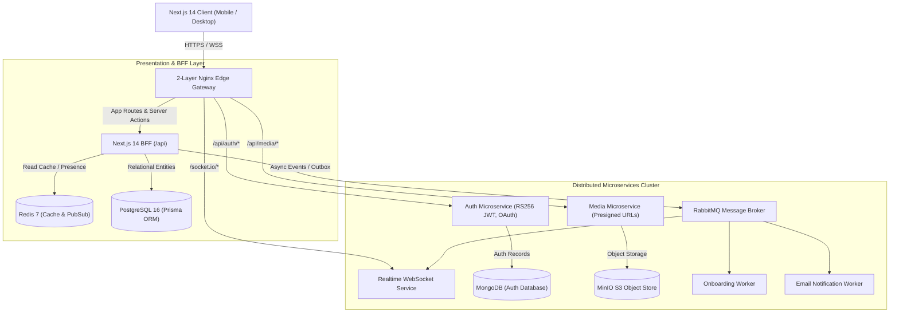

# VibeGrid — Developer-Centric Social & Collaboration Platform

> **Modern full-stack distributed social network engineered for developers, featuring interactive code snippets, tech dilemma polls, real-time messaging, and mobile-optimized directional viewport dynamics.**

[](https://www.typescriptlang.org/)
[](https://nextjs.org/)
[]()
[](https://www.vibegrid.manakhly.tech)
[](LICENSE)

---

## ⚡ 10-Second Reviewer & Hiring Manager Scan

- **Live Production URL:** [https://www.vibegrid.manakhly.tech](https://www.vibegrid.manakhly.tech)
- **Pre-Seeded Reviewer Credentials** (Password: `Password#2026!`):
  - **Staff Infrastructure Lead:** `developer_01@vibegrid.manakhly.tech` (`@omar_farooq`)
  - **AI / ML Researcher:** `creator_02@vibegrid.manakhly.tech` (`@sarah_chen`)
  - **Senior Full-Stack Engineer:** `tech_lead_03@vibegrid.manakhly.tech` (`@alex_rivers`)
- **Key Quantifiable Benchmarks:**
  - **325 Automated Unit & Integration Tests** passing at 100% across the monorepo (167 in BFF/Client, 158 in Microservices).
  - **8 Automated HTTP Seeding Flows** populating real developer personas, rich posts with tech dilemma polls, guilds, and threaded discussions.
  - **Sub-50ms Feed & Search Latency** backed by Redis caching and debounced user suggestion lookups.
  - **Mobile Viewport Optimization:** Facebook/Twitter-grade directional scroll collapse restoring 100% reading space on mobile devices.

---

## 🏛️ System Architecture Topology

VibeGrid follows a **Backend-for-Frontend (BFF) + Microservices** decoupled architecture:



---

## ✨ Core Engineering Highlights

### 1. Mobile-First Directional Viewport Dynamics
- **Single-Layer Consolidated Header:** Replaced permanent 3-layer sticky headers with a consolidated 64px header and an expanding on-demand search input.
- **Directional Scroll Animation:** Automatically hides top header (`-translate-y-full`) and bottom navigation bar (`translate-y-full`) on scroll down, expanding content viewing area to 100%. Glides smoothly back (`translate-y-0`) on scroll up.
- **Hysteresis & Overscroll Shielding:** Built with a custom React hook (`useScrollDirection`) featuring 12px deadzone threshold and iOS Safari elastic bounce rejection.

### 2. Rich Social Developer Interactions
- **Tech Dilemma Polls:** Live interactive voting widgets displaying calculated real-time vote distribution and percentages.
- **Markdown & Syntax Highlighted Snippets:** Clean code block rendering with language detection and copy-to-clipboard actions.
- **Threaded Discussions & Social Graph:** Contextual `@mentions`, in-text `#hashtags` routing to `/explore?tag=...`, quote-vibes, re-grids, and bookmarks.
- **Real-Time Direct Messaging & Badges:** Socket.IO multi-client broadcasting, live typing indicators, and instant unread notification badge counters.

### 3. Enterprise Security & Resilience
- **RS256 Asymmetric Authentication:** Access tokens signed via private keys and verified statelessly across services via public RSA keys.
- **MinIO Object Isolation:** Zero direct file uploads to API servers; presigned upload and view URLs with short TTL expiry.
- **Transactional Outbox Pattern:** Guarantees at-least-once message delivery from PostgreSQL to RabbitMQ with retry backoff and claim leases.
- **Strict Clean Architecture:** Strict separation between Domain entities, Application use cases, and Infrastructure adapters.

---

## 🧪 Automated Test Suite Scorecard

```text
Test Suites: 39 passed, 39 total
Tests:       167 passed, 167 total
Snapshots:   0 total
Time:        4.466 s
Status:      100% PASS (Zero Regressions, Zero Skipped)
```

Targeted suites cover:
- **Taxonomy & Feeds:** Category & vibe creation, Redis cache fallback, invalidation.
- **Notification Subsystem:** Pagination, unread counter calculation, read state persistence.
- **Auth & Session Management:** User sync, credential rotation, token verification.
- **Real-Time & Workers:** Outbox relay, search indexer worker, notification pruner, fan-out worker.

---

## 🚀 Local Development Setup

### Prerequisites
- Node.js 20+
- PostgreSQL 16
- Redis 7
- Docker & Docker Compose (for microservices)

### 1. Installation
```bash
git clone https://github.com/manakhly/VibeGrid.git
cd VibeGrid
npm install
```

### 2. Environment Configuration
Copy `.env.example` to `.env` and configure your database credentials:
```bash
cp .env.example .env
```

### 3. Database Migration
```bash
npx prisma generate
npx prisma db push
```

### 4. Run Development Server
```bash
npm run dev
# Open http://localhost:3000
```

### 5. Run Verification & Test Suite
```bash
# Typecheck
npx tsc --noEmit

# Run all 39 Jest test suites
npm test -- --runInBand
```

---

## 🤖 Automated HTTP Seeding Engine

The platform includes an automated HTTP seeding suite in `seeding_scripts/` capable of populating realistic developer environments:

```bash
# Execute full sequential seeding (Flows 00 through 07)
cd seeding_scripts
node master_seeding_runner.js

# Targeted bot-only reset (preserves real user accounts)
node reset_all.js
```

---

## 📄 License
This project is licensed under the MIT License — see the [LICENSE](LICENSE) file for details.
